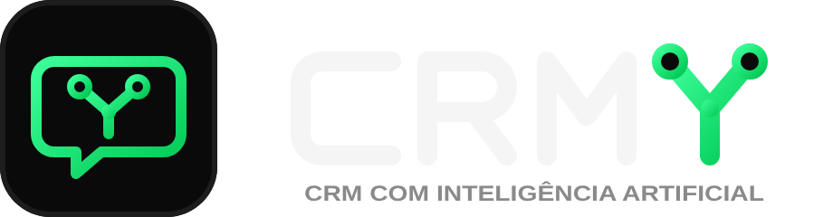

# CRMY: CRM com IA

CRM da RBTech Celulares com uma IA (Claude, da Anthropic) que atende clientes, vende iPhones pelo catálogo, marca compromissos e aprende o jeito do dono de escrever. É um app de um arquivo só (`index.html`), sem servidor e sem build.

## O que tem

- **Conversas:** a IA atende o cliente em três modos por conversa: responde sozinha, sugere e você envia, ou só você responde.
- **Funil em cards:** a IA move o cliente entre as fases e atualiza temperatura (quente, morno, frio), valor do negócio, próximo passo e um resumo, conforme a conversa anda.
- **Follow-up:** quando o cliente para de responder, a IA manda uma mensagem para retomar a conversa, nos dias que você escolher (ex.: 1, 3 e 7 dias), só no horário permitido. Sem resposta depois da última tentativa, o cartão vai para Perdido; se o cliente voltar a falar, volta sozinho para o funil.
- **Aprovação antes de vender:** antes de fechar qualquer venda, a IA pergunta ao dono se tem em estoque e se o valor está certo.
- **Agenda:** retiradas, entregas de iPhone, orçamentos e reparos, com Google Agenda opcional.
- **Dados do site da loja:** o CRM importa tudo do site (repositório `rb-tech-celulares`, arquivo `data/catalogo.json`): aparelhos com preço, foto, cor, bateria e garantia, taxas de cada parcela do cartão (até 24x), tabela de troca do usado, cupons, campanhas, políticas, benefícios e reparos. A IA calcula parcelas e avaliação do usado com as mesmas contas do site, e se atualiza sozinha quando o admin do site publica uma mudança.
- **Aprendizado do estilo do dono** a partir de conversas exportadas do WhatsApp.
- **Marca personalizável** (nome, logo, cor) e pacote de configuração para revender a outras lojas.

## Custo da IA

O modelo padrão é o **Claude Haiku 5.5**, o mais barato: para 20 a 25 clientes por dia, fica em torno de **US$ 5 a 10 por mês**. Em Configurações > Inteligência artificial dá para trocar pelo Sonnet 5.5 (cerca de US$ 100 a 175 por mês) ou pelo Opus 5.5 (cerca de US$ 200 a 350 por mês), que negociam melhor. O Painel mostra o gasto estimado do mês.

## WhatsApp de verdade, 24 horas (Z-API)

A IA roda no servidor (`api/whatsapp.js` → `lib/atendimento.js`, com o mesmo núcleo do CRM em `nucleo/negocio.js`) e atende mesmo com o CRM fechado:

- **À noite** (padrão: das 20h às 8h, em Configurações > Inteligência artificial) a IA responde sozinha.
- **De dia** vale o botão em **`/modo`**: um toque alterna entre *A IA responde sozinha*, *A IA sugere, eu aprovo* (a sugestão aparece no CRM) e *Eu respondo*.
- **Aprovações** chegam no WhatsApp do dono (Configurações > Dono). Responda `sim`, `não` ou `sim 3799`; com mais de um pedido, `A2 sim`.
- **Quando você responde pelo celular**, a mensagem entra no CRM, a IA aprende com ela e fica quieta naquela conversa por algumas horas.
- **Saudação com menu**: na primeira mensagem do cliente e quando ele volta depois de 5 dias sem conversa, vai na hora o menu de boas-vindas (editável em Configurações > Saudação com menu). Se ele mandou só "oi", a IA espera a escolha; se já perguntou algo, responde logo depois.
- **Áudios** do cliente são transcritos; com a voz configurada, a IA responde com um áudio curto na voz do dono.
- **Follow-ups** saem pela rotina `/api/rotina`: uma vez por dia pela agenda da Vercel (10h07), a cada 10 minutos enquanto o CRM estiver aberto em algum aparelho, ou por um agendador externo chamando `https://SEU-SITE/api/rotina?chave=ZAPI_WEBHOOK_SEGREDO`.

Para ligar:

1. Na [Z-API](https://z-api.io), crie uma instância e leia o QR Code com o celular da loja (WhatsApp > Aparelhos conectados).
2. Cadastre na Vercel `ZAPI_INSTANCIA`, `ZAPI_TOKEN`, `ZAPI_WEBHOOK_SEGREDO` (e `ZAPI_CLIENT_TOKEN`, se ativou o token de segurança) e faça Redeploy.
3. Na Z-API, em Webhooks, cadastre `https://SEU-SITE/api/whatsapp?chave=ZAPI_WEBHOOK_SEGREDO` em **Ao receber** e ative **Notificar as enviadas por mim** com o mesmo endereço. Abrindo esse endereço no navegador, ele diz se a chave está certa.
4. No CRM, em Configurações > Dono, coloque o seu WhatsApp **pessoal** (é para onde vão os pedidos de aprovação).

A Z-API não é a API oficial do WhatsApp: o número pode ser banido, principalmente com muitas mensagens para quem não falou com você. A IA só responde quem chamou e faz poucos follow-ups, o que reduz o risco.

## Resposta em áudio (rapport)

Com `ELEVENLABS_API_KEY` e `ELEVENLABS_VOICE_ID`, quando o cliente manda áudio a IA responde com um áudio curto **na voz clonada do dono** (cumprimenta, mostra que entendeu, cria conexão) e manda preços e parcelas em texto logo depois. Os áudios dos clientes são transcritos (`api/transcrever.js`, ElevenLabs Speech to Text) e a fala é gerada em `api/voz.js`. Em **Configurações > Voz e áudio** dá para escolher quando responder em áudio e ouvir um teste da voz.

## Marca CRMY

Logos em [`marca/`](marca/): `crmy-logo.svg` (fundo escuro), `crmy-logo-fundo-claro.svg`, `crmy-icone.svg` e as versões em PNG.

## Publicar na Vercel

1. Em [vercel.com](https://vercel.com) > **Add New > Project**, importe este repositório.
2. Em **Framework Preset**, escolha **Other**. Não precisa de comando de build.
3. Em **Settings > Environment Variables**, cadastre (para Production, Preview e Development):

| Variável | O que é |
|---|---|
| `CRM_USUARIO` | Usuário do login do CRM (ex.: `RBTech`) |
| `CRM_SENHA` | Senha do login do CRM. Marque como **Sensitive**. |
| `ANTHROPIC_API_KEY` | Chave da API da Anthropic (console.anthropic.com > API Keys). Marque como **Sensitive**. |
| `SUPABASE_URL` | Project URL do Supabase (`https://xxxx.supabase.co`) |
| `SUPABASE_PUBLISHABLE_KEY` | Chave *publishable* (ou *anon public*) do Supabase |
| `SUPABASE_EMAIL` | E-mail do usuário criado no Supabase (Authentication > Users) |
| `SUPABASE_SENHA` | Senha desse usuário do Supabase. Marque como **Sensitive**. |
| `GOOGLE_CLIENT_ID` | Client ID do Google Agenda (opcional) |
| `ELEVENLABS_API_KEY` | Chave da API da ElevenLabs, para a IA responder em áudio com a sua voz (opcional). Marque como **Sensitive**. |
| `ELEVENLABS_VOICE_ID` | ID da voz clonada na ElevenLabs (opcional) |
| `ELEVENLABS_MODEL` | Modelo da fala (opcional; padrão `eleven_multilingual_v2`) |
| `ZAPI_INSTANCIA` | "ID do canal" no Omni Z-API (ou ID da instância na Z-API clássica) |
| `ZAPI_SECRET` | Omni Z-API: a Secret Key (menu Segurança). Marque como **Sensitive**. |
| `ZAPI_TOKEN` | Token do canal/instância (no Omni é opcional: o CRM busca sozinho). Marque como **Sensitive**. |
| `ZAPI_CLIENT_TOKEN` | Token de segurança da conta Z-API, se você ativou (opcional). Marque como **Sensitive**. |
| `ZAPI_WEBHOOK_SEGREDO` | Uma senha que você inventa; vai no endereço cadastrado na Z-API |
| `CRON_SECRET` | Senha da rotina diária de follow-ups da Vercel (opcional; a Vercel manda sozinha) |

4. Clique em **Deploy** (ou, se o projeto já existia, **Deployments > ⋯ > Redeploy**, porque variável nova só vale depois de publicar de novo).

O CRM abre numa tela de login (usuário e senha das variáveis `CRM_USUARIO` e `CRM_SENHA`) e não tem nenhum campo de chave ou de conexão: a IA, o Supabase e o Google vêm das variáveis. O servidor confere o login (`api/login.js`; 5 senhas erradas seguidas bloqueiam por 15 minutos) e entra no Supabase com `SUPABASE_EMAIL` e `SUPABASE_SENHA`. A IA passa por `api/anthropic.js`, que só atende quem está logado: o navegador nunca recebe a chave da Anthropic.

Cada novo push na branch `main` publica de novo sozinho.

## Primeiro uso

1. Abra o endereço da Vercel no navegador do computador da loja.
2. **Configurações > Inteligência artificial:** cole a chave da API da Anthropic (console.anthropic.com).
3. **Catálogo:** preencha os preços.
4. **Painel > Simular cliente no WhatsApp** para ver a IA atender.

## Salvar na nuvem (Supabase)

Sem o Supabase, os dados ficam só no navegador. Com ele, clientes, conversas, funil, aprovações, agenda, catálogo, configurações e o estilo de escrita ficam salvos na nuvem e aparecem no computador e no celular.

1. No [Supabase](https://supabase.com) (pode ser o mesmo projeto do site), abra **SQL Editor**, cole [`supabase/crm.sql`](supabase/crm.sql) e clique em **Run**.
2. Em **Authentication > Users > Add user**, crie o usuário que o CRM usa por trás (e-mail e senha, com *Auto Confirm User*). Esse e-mail e essa senha vão nas variáveis `SUPABASE_EMAIL` e `SUPABASE_SENHA`.
3. Em **Authentication > Sign In / Providers**, desligue **Allow new users to sign up**.
4. Coloque a Project URL e a chave nas variáveis da Vercel (acima).

Só o usuário logado lê e grava os dados (RLS).

## Importante

- **Sem o Supabase, os dados ficam no navegador de quem usa.** O computador e o celular têm dados separados. Use **Configurações > Baixar backup** com frequência.
- **Ninguém mais vê os seus dados:** quem abrir o mesmo endereço sem o seu login vê um app vazio.
- **Os follow-ups saem enquanto o app estiver aberto** em algum navegador.
- **WhatsApp:** por enquanto é um simulador. Para a IA atender o WhatsApp de verdade, é preciso um servidor que receba as mensagens (próxima fase). No WhatsApp oficial, depois de 24 horas sem o cliente falar, só é possível mandar mensagens com modelo aprovado pela Meta, o que vale para os follow-ups.
- **Google Agenda:** no Google Cloud, cadastre o endereço da Vercel (ex.: `https://SEU-PROJETO.vercel.app`) em **Origens JavaScript autorizadas** do Client ID. O passo a passo está em Configurações > Google Agenda.
